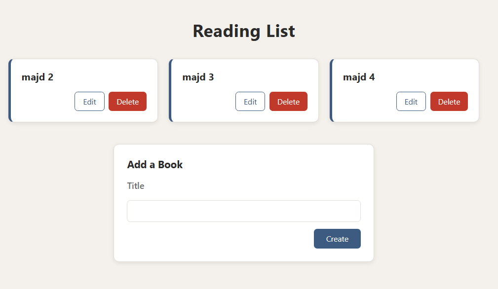

# Book List App

A small React application for managing a personal reading list. Add books, edit their titles, and delete them, all with a clean card-based interface.



## Features

- **Add** a new book by entering its title
- **Edit** a book's title inline
- **Delete** a book from the list
- Responsive card grid layout
- State managed entirely with React hooks (`useState`)

## Project Structure

```
src/
├── App.jsx                  # Root component, holds the books state
├── index.css                # Global styles
└── components/
    ├── BookCreate.jsx       # Form to add a new book
    ├── BookEdit.jsx         # Form to edit a book's title
    ├── BookList.jsx         # Renders the list of books
    └── BookShow.jsx         # Single book card with Edit/Delete actions
```

## Component Overview

| Component    | Responsibility                                                  |
| ------------ | --------------------------------------------------------------- |
| `App`        | Owns the `books` state and the create, edit and delete handlers |
| `BookCreate` | Controlled input form that calls `onCreateBook(title)`          |
| `BookList`   | Maps over `books` and renders a `BookShow` for each             |
| `BookShow`   | Displays a title, toggles edit mode, and triggers delete        |
| `BookEdit`   | Controlled input form that calls `onSubmit(id, title)`          |

## Getting Started

### Prerequisites

- [Node.js](https://nodejs.org/) 18 or later
- npm (comes with Node.js)

### Installation

```bash
# Clone the repository
git clone <your-repo-url>
cd <your-project-folder>

# Install dependencies
npm install
```

### Run the app

```bash
npm run dev
```

Then open the URL shown in the terminal (usually `http://localhost:5173`).

> If your project was created with Create React App, use `npm start` instead.

### Build for production

```bash
npm run build
```

## How It Works

1. `App` keeps an array of books in state: `{ id, title }`.
2. `BookCreate` sends a new title up to `App`, which appends a book with a random id.
3. `BookList` passes each book to `BookShow`.
4. `BookShow` switches between a title view and the `BookEdit` form.
5. Saving an edit or clicking Delete calls back to `App`, which updates the state immutably.

## Styling

Styles live in `src/index.css` and use CSS variables defined in `:root`, so you can change the color scheme by editing a few values.

## Tech Stack

- React
- JavaScript (JSX)
- Plain CSS

## License

This project is open source and available under the [MIT License](LICENSE).
